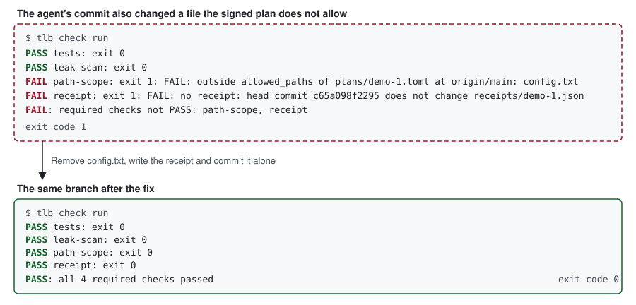

# tiller-book

Check an agent's work against a plan a person signed, and keep a receipt for every change.

[](https://github.com/sourav-patra/tiller-book/releases)
[](LICENSE)
[](pyproject.toml)
[](docs/status-and-limits.md)



Real `tlb` output from a test repository: a commit outside the plan fails with the path named, and the fixed branch passes.

Status: 0.1.0-alpha. Checks run when someone runs them. No CI gate blocks a merge yet.

## Why tiller-book

An agent's word is not evidence. Saying "done" does not tell you what it changed or whether that was agreed.

You give tiller-book a plan a person signed and a branch an agent built. You get PASS or FAIL for each check and a receipt for the change. You then decide whether to merge.

Evidence: this repository is built this way, with 7 [signed plans](plans/) and 7 [receipts](receipts/).

## Features

- Signed plans: a plan counts only if a commit signed with a listed key put it on main.
- Path scope: a change fails if it touches a path its plan does not allow.
- Fail-closed checks: a check that fails, times out or cannot run counts as a failure.
- Receipts: one file per unit records its commits, its checks and the model use the caller reports.
- Release gate: before going public, scan the history for deny-listed text, personal email addresses and secrets.
- Not yet: reviewer identity, CI gates and lesson filing are planned for 0.1.

## Quick start

You need Python 3.11 or later, git, `ssh-keygen` and `gitleaks` on `PATH`.

1. Clone the repository and install it in a virtual environment. The `[test]` extra installs pytest, which the `tests` check runs. `tlb --help` then lists the commands.

   ```sh
   git clone https://github.com/sourav-patra/tiller-book.git
   cd tiller-book
   pip install ".[test]"
   tlb --help
   ```

2. Verify a signed plan.

   ```sh
   tlb plan verify U1
   ```

   ```text
   PASS: plans/U1.toml at origin/main is valid and signed by a key in .github/allowed_signers at origin/main
   ```

3. Run the checks. The test suite takes about 5 minutes (measured on one Windows machine).

   ```sh
   tlb check run
   ```

   ```text
   PASS tests: exit 0
   PASS leak-scan: exit 0
   PASS path-scope: exit 0
   PASS receipt: exit 0
   PASS: all 4 required checks passed
   ```

To try it on your own work, follow [Use it in your own repository](docs/use-in-your-repo.md).

## How it works


How one change moves. Scripts decide steps 3 and 7, and a person decides steps 2 and 8. Step 5 is a process in this release: nothing checks who the reviewer was.


Why an agent cannot widen its own limit. The checks read the limit from `origin/main` and the work from the branch. This holds only while the agent cannot merge to main.

## Status and limits

- Checks count only when someone runs them, because no CI gate exists yet.
- This release does not check who reviewed a change.
- tiller-book does not control who can merge. An agent that can merge to main can add its own signing key, so keep the merge right with a person.
- The receipt check proves the receipt's shape and its binding to the head commit. It does not prove the listed checks ran.

[Every known limit](docs/status-and-limits.md) is listed with what is enforced today.

## Documentation

- [How it works](docs/how-it-works.md): who it is for, the three concepts, and what a receipt records.
- [Use it in your own repository](docs/use-in-your-repo.md): the steps, with their output.
- [Commands](docs/commands.md): every `tlb` command and option.
- [Status and limits](docs/status-and-limits.md): what is enforced now and what is not yet.
- [Comparison](docs/comparison.md): nearby projects, described in their own terms.
- [Contributing](CONTRIBUTING.md) and [vision](VISION.md).

## Licence

MIT. See [LICENSE](LICENSE).
