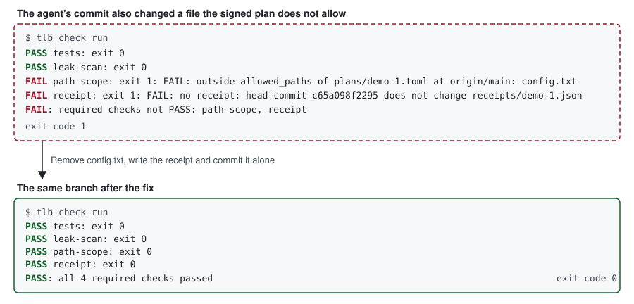

# tiller-book documentation

Check an agent's work against a plan a person signed, and keep a receipt for every change.

- [How it works](how-it-works.md): who it is for, the three concepts, and what a receipt records.
- [Use it in your own repository](use-in-your-repo.md): the steps, with their output.
- [Commands](commands.md): every `tlb` command and option.
- [Status and limits](status-and-limits.md): what is enforced now, what is not yet, and every known limit.
- [Comparison](comparison.md): nearby projects, described in their own terms.

Source and quick start: [README](https://github.com/sourav-patra/tiller-book/blob/main/README.md). Contributing: [CONTRIBUTING.md](https://github.com/sourav-patra/tiller-book/blob/main/CONTRIBUTING.md). Vision: [VISION.md](https://github.com/sourav-patra/tiller-book/blob/main/VISION.md).
